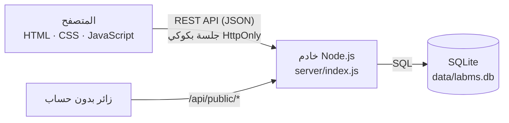
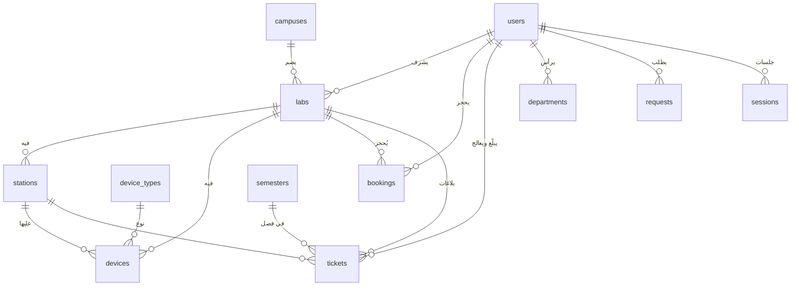

# مِختبَر — نظام إدارة المعامل

منصة ويب عربية لإدارة معامل الكلية: حجز المعامل بدون تعارض، سجل الأجهزة ومواعيد معايرتها، بلاغات الصيانة، التقارير، وإدارة المستخدمين والصلاحيات.

تعمل المنصة بالكامل داخل المتصفح. لا تحتاج قاعدة بيانات ولا خادمًا ولا تثبيت أي برنامج.

## التشغيل على الجهاز

المنصة نظام كامل: **واجهة أمامية + خادم (Backend) + قاعدة بيانات**.

### 1) التشغيل الكامل مع الخادم وقاعدة البيانات (الموصى به)
1. ثبّت **Node.js 24 LTS** من https://nodejs.org (مرة واحدة فقط). لا توجد مكتبات أخرى تحتاج تثبيتًا.
2. شغّل الخادم:
   - ويندوز: اضغط مرتين على `start.bat`
   - ماك / لينكس: `./start.sh`
   - أو من الطرفية: `node server.js`
3. افتح **http://localhost:3000**

عند أول تشغيل تُنشأ قاعدة البيانات `data/labms.db` تلقائيًا وفيها البيانات التجريبية. يستطيع أكثر من شخص على نفس الشبكة استخدام المنصة معًا عبر `http://عنوان-جهازك:3000`، وتتحدث الشاشات تلقائيًا عند تغيّر البيانات.

### 2) التشغيل عبر Docker
```bash
docker compose up -d
```
ثم افتح http://localhost:3000. تبقى البيانات محفوظة في volume باسم `labms-data`.

### 3) وضع العرض بدون خادم
افتح `index.html` مباشرة بالضغط عليه مرتين. تعمل كل الشاشات، وتُحفظ البيانات في متصفح الجهاز فقط. مفيد إذا لم يتوفر Node.js وقت العرض.

> الخطوط تُحمَّل من Google Fonts عند توفر الإنترنت. بدون إنترنت تعمل المنصة بخطوط النظام.

## حسابات العرض

| الدور | اسم المستخدم | كلمة المرور |
|---|---|---|
| مدير النظام | `admin` | `admin123` |
| مشرف معمل | `supervisor` | `super123` |
| عضو هيئة تدريس | `faculty` | `faculty123` |
| الدعم الفني | `it` | `it123` |
| عضو لجنة المعامل | `committee` | `committee123` |
| طالب | `student` | `student123` |
| زائر | بدون حساب | من شاشة الدخول: «الإبلاغ عن عطل بدون حساب» و«تتبع بلاغ» |

في شاشة الدخول توجد أزرار تدخل بكل حساب بضغطة واحدة.

حسابات إضافية لتجربة الطلبات بين الأقسام: `majed` / `majed123` (مشرف الكيمياء)، و`saud` / `saud123` (رئيس قسم الهندسة الكهربائية). حساب `faculty` هو رئيس قسم الفيزياء.

## مطابقة مشروع التخرج

المنصة مبنية على نفس هيكل مشروع التخرج (Symfony + EasyAdmin):

- **الهيكل:** الحرم الجامعي ← المعمل ← المحطة ← الجهاز. لكل جهاز نوع (من «أنواع الأجهزة») ورقم تسلسلي وباركود.
- **الأدوار:** مدير النظام، مشرف معمل (Staff)، الدعم الفني (IT Support)، عضو لجنة المعامل (Committee Member)، عضو هيئة تدريس، طالب، وزائر (Guest) بدون حساب.
- **البلاغات (Issues):** عنوان، نوع العطل، الحرم والمعمل والمحطة، **عدة أجهزة**، وصف، **صور مرفقة**، الفصل الدراسي، والحالة.
- **موافقات متعددة المستويات:** المستوى 1 مشرف المعمل ← المستوى 2 **تحويل للدعم الفني** (Forward to IT) ← المستوى 3 **لجنة المعامل** تعتمد الشراء أو الاستبدال أو إخراج الجهاز من الخدمة. لا يُغلق البلاغ قبل قرار اللجنة.
- **التعليقات:** خيار «مرئي للمبلّغ» للملاحظات الداخلية، مع إرفاق صور.
- **الواجهة العامة:** يستطيع الزائر الإبلاغ عن عطل ببريده، ثم **تتبع الحالة** برقم البلاغ والبريد.
- **الفصول الدراسية:** كل بلاغ مرتبط بفصله، والتقارير تُعرض حسب الفصل الحالي.

## الوحدات

- **لوحة التحكم:** مؤشرات المعامل والأجهزة والحجوزات والبلاغات، إشغال كل معمل خلال الأسبوع، حالة الأجهزة، جدول اليوم، الطلبات المعلقة، وآخر النشاطات.
- **الحرم الجامعي:** المواقع ومعاملها ومحطاتها وجاهزية أجهزتها وبلاغاتها المفتوحة.
- **المحطات:** خريطة محطات لكل معمل، لون كل محطة حسب أسوأ حالة لأجهزتها، والإبلاغ عن عطل من المحطة مباشرة.
- **موافقات اللجنة:** قائمة الطلبات المعلقة بتكلفتها ومبرراتها، وسجل القرارات.
- **البيانات المرجعية:** أنواع الأجهزة والفصول الدراسية.
- **المعامل:** بطاقات لكل معمل (السعة، الأجهزة العاملة، الإشغال)، وصفحة تفاصيل فيها الأجهزة والحجوزات وسجل الصيانة.
- **الأجهزة والمعدات:** رقم الأصل، الطراز، الرقم التسلسلي، الضمان، **وتنبيه تلقائي بمواعيد المعايرة** المتأخرة والقريبة. بحث وتصفية وتصدير CSV.
- **صفحة لكل جهاز (التتبع):** لوحة رقم الأصل والرقم التسلسلي، المعمل والقسم، الضمان، المعايرة القادمة وآخر معايرة، وعدد البلاغات. **سجل الجهاز** يحفظ تلقائيًا كل ما حدث له: التسجيل، تغيّر الحالة، النقل بين المعامل، المعايرات، التعديلات، البلاغات وخطوات حلها، وطلبات الإعارة والنقل، مع اسم من قام بالإجراء ووقته.
- **تسجيل المعايرة:** التاريخ، النتيجة (مطابقة أو غير مطابقة)، رقم الشهادة، والموعد القادم. إذا كانت النتيجة غير مطابقة يتحول الجهاز إلى «في الصيانة».
- **صفحة لكل بلاغ:** مراحل الإبلاغ ← المعالجة ← الحل، تحويل البلاغ لمسؤول آخر، تحديثات ومراسلات، ولا يُغلق البلاغ إلا بكتابة **الإجراء المتخذ**. عند الحل يعود الجهاز إلى «يعمل» تلقائيًا.
- **سجل أحداث المعمل:** تبويب في صفحة كل معمل يجمع حركة كل أجهزته وبلاغاته.
- **الجدول الأسبوعي:** شبكة الأحد إلى الخميس لكل معمل. اضغط على أي ساعة فارغة لتحجزها.
- **الحجوزات:** يمنع النظام التعارض في الوقت، وتجاوز سعة المعمل، والحجز خارج ساعات الدوام أو في يوم مضى أو في معمل تحت الصيانة. طلبات الطلاب وأعضاء هيئة التدريس تصل إلى مشرف المعمل ليوافق عليها أو يرفضها مع ذكر السبب.
- **الصيانة والأعطال:** بلاغ مرتبط بجهاز معين أو بالمعمل كله، بأولوية (منخفضة، متوسطة، عالية، عاجلة)، ويمر بالمراحل: مفتوح ← قيد المعالجة ← تم الحل. تتغير حالة الجهاز تلقائيًا.
- **الطلبات بين الأقسام:** صندوق وارد وصادر لكل قسم، بستة أنواع: إعارة جهاز، استخدام معمل، مواد ومستلزمات، دعم فني، نقل عهدة، وطلب عام. لكل طلب رقم مرجعي (REQ-2026-0143) ومسار واضح من القسم المرسل إلى القسم المستلم، ومراحل: الإرسال ← المراجعة ← الاعتماد ← التنفيذ ← الإكمال. يستطيع القسم المستلم أن يعتمد الطلب أو يرفضه مع ذكر السبب أو يطلب استكمال معلومات، وفيه سجل مراسلات بين القسمين. عند اعتماد طلب استخدام معمل يُضاف الحجز إلى جدول المعمل تلقائيًا، وعند إكمال نقل العهدة ينتقل الجهاز إلى المعمل الجديد. وتظهر الطلبات المتأخرة عن موعدها بلون مميز.
- **التقارير:** الحجوزات وساعات الاستخدام ونسب الإشغال والامتلاء لكل معمل، وتوزيع الحجوزات على أيام الأسبوع، والبلاغات حسب الأولوية، والوارد والصادر والمتأخر ومتوسط مدة الإنجاز في الطلبات بين الأقسام.
- **المستخدمون والأقسام:** إضافة الحسابات وتعديلها وإيقافها، وإدارة الأقسام (الرمز، رئيس القسم، التحويلة)، ومصفوفة الصلاحيات. إذا تغيّر اسم قسم يتحدث في كل المعامل والمستخدمين والطلبات.
- **الإعدادات:** الملف الشخصي وتغيير كلمة المرور، المظهر الفاتح أو الداكن، نسخة احتياطية JSON واستعادتها، وإعادة البيانات التجريبية.

## اختصارات مفيدة أثناء العرض

- **`Ctrl+K`** أو **`/`**: بحث سريع في كل المنصة (معمل، جهاز برقم الأصل، طلب برقمه، حجز، بلاغ).
- **طباعة نموذج الطلب:** من صفحة أي طلب بين الأقسام، زر «طباعة» يطبع نموذجًا رسميًا بحجم A4 فيه خانات توقيع لمقدم الطلب ورئيسي القسمين. يظهر الزر عند فتح المنصة من الملف على الجهاز.
- **الإشعارات:** العداد يُصفّر بعد فتح قائمة الإشعارات، ويرجع فقط إذا وصلت إشعارات جديدة.


## البنية التقنية



| الطبقة | التقنية | الملفات |
|---|---|---|
| الواجهة الأمامية | HTML + CSS + JavaScript بدون أطر عمل، عربية RTL، فاتح وداكن، متجاوبة | `index.html`، `assets/` |
| الخادم | Node.js (وحدة `http` المدمجة) بدون مكتبات خارجية | `server.js`، `server/index.js` |
| قاعدة البيانات | SQLite المدمجة في Node.js (`node:sqlite`) مع مفاتيح أجنبية وفهارس | `server/db.js` |
| البيانات التجريبية | وحدة مشتركة بين المتصفح والخادم | `assets/js/seed.js` |

### الأمان والصلاحيات على الخادم
- كلمات المرور مشفرة بـ **scrypt** مع salt لكل مستخدم، ولا تُرسل أبدًا إلى المتصفح.
- جلسات في جدول `sessions` بكوكي **HttpOnly / SameSite=Lax** صالحة 7 أيام.
- كل عملية كتابة تمر على قواعد صلاحيات على الخادم حسب الدور (مثال: الطالب لا يستطيع تعديل معمل، ومشرف المعمل يعدّل أجهزة معامله فقط).
- قواعد العمل تُفرض على الخادم أيضًا: منع تعارض الحجوزات وتجاوز السعة، منع إغلاق البلاغ قبل قرار اللجنة، قرار اللجنة للجنة فقط، أرقام البلاغات والطلبات فريدة.
- الآثار الجانبية ينفذها الخادم: تحويل الأجهزة إلى «في الصيانة» عند البلاغ وإعادتها عند الحل، إنشاء الحجز عند اعتماد طلب استخدام معمل، نقل الجهاز عند إكمال نقل العهدة.
- الملاحظات الداخلية وبريد الزائر لا تصل لمن لا يعالج البلاغ.
- لا يمكن تنزيل ملفات الخادم أو قاعدة البيانات من المتصفح.

### الواجهة البرمجية (API)

| الطريقة | المسار | الوصف |
|---|---|---|
| GET | `/api/health` | حالة الخادم |
| GET | `/api/data` | البيانات المسموح للمستخدم الحالي برؤيتها |
| POST | `/api/auth/login` · `/api/auth/logout` | الدخول والخروج |
| POST | `/api/auth/password` | تغيير كلمة المرور |
| PUT / DELETE | `/api/{collection}/{id}` | إضافة أو تعديل أو حذف (labs، devices، stations، bookings، tickets، requests، users، …) |
| POST | `/api/activity` | تسجيل نشاط |
| POST | `/api/public/tickets` | إبلاغ زائر |
| POST | `/api/public/track` · `/api/public/comment` | تتبع البلاغ والرد عليه برقمه وبريده |
| GET / POST | `/api/admin/export` · `/api/admin/import` · `/api/admin/reset` | النسخ الاحتياطي والاستعادة وإعادة البيانات التجريبية (للمدير) |

### مخطط قاعدة البيانات



الجداول: `campuses`، `labs`، `stations`، `device_types`، `devices`، `users`، `departments`، `semesters`، `bookings`، `tickets`، `requests`، `activity`، `sessions`، `counters`. السجلات المتداخلة (سجل الجهاز، خطوات البلاغ، المرفقات، بنود الطلب) محفوظة كأعمدة JSON داخل جداولها.

## الصلاحيات

| | مدير النظام | مشرف معمل | هيئة تدريس / طالب |
|---|:-:|:-:|:-:|
| طلب حجز والإبلاغ عن عطل | ✓ | ✓ | ✓ |
| تأكيد الحجز مباشرة والموافقة على الطلبات | ✓ | معامله فقط | — |
| إدارة الأجهزة ومعالجة البلاغات | ✓ | معامله فقط | — |
| التقارير | ✓ | معامله فقط | — |
| إرسال طلب إلى قسم آخر | ✓ | ✓ | هيئة التدريس فقط |
| البت في الطلبات الواردة للقسم | ✓ | قسمه | رئيس القسم |
| إضافة المعامل وحذفها وإدارة المستخدمين | ✓ | — | — |

## هيكل الملفات

```
index.html             صفحة التطبيق
assets/css/style.css   التصميم (فاتح وداكن ومتجاوب مع الجوال)
assets/js/seed.js      البيانات التجريبية (مشتركة مع الخادم)
assets/js/store.js     طبقة البيانات: تتصل بالخادم، أو تحفظ محليًا بدون خادم
assets/js/ui.js        الأيقونات والنوافذ والرسوم البيانية
assets/js/app.js       الشاشات وقواعد العمل في الواجهة
server.js              نقطة تشغيل الخادم
server/index.js        الواجهة البرمجية والصلاحيات وقواعد العمل
server/db.js           قاعدة البيانات SQLite والجداول وتشفير كلمات المرور
data/labms.db          قاعدة البيانات (تُنشأ تلقائيًا)
Dockerfile، docker-compose.yml   التشغيل بالحاويات
start.bat / start.sh   تشغيل الخادم بضغطة
```

## ملاحظات

- مع الخادم: البيانات في `data/labms.db`. لإعادة البيانات التجريبية: من الإعدادات بحساب المدير، أو احذف مجلد `data` وأعد التشغيل.
- بدون خادم: تُحفظ البيانات في متصفح الجهاز (localStorage).
- لإرجاع البيانات كما كانت قبل العرض: **الإعدادات ← إعادة البيانات التجريبية** (بحساب المدير).
- في عطلة نهاية الأسبوع (الجمعة والسبت) تعرض اللوحة والجدول **الأسبوع الدراسي القادم**.
- للنشر على خادم الجامعة: شغّل الحاوية (Docker) خلف HTTPS، وغيّر كلمات مرور الحسابات التجريبية.
